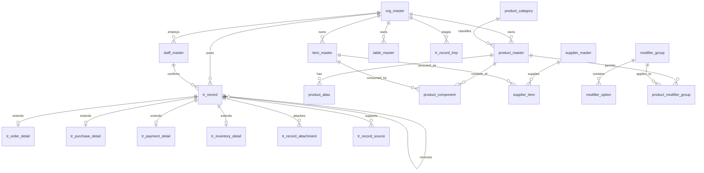

# 業務基盤の設計思想とテーブル構成

## 1. この文書の位置付け

本書は、介護システムで設計したNEW GL型の業務記録基盤を、飲食店システムを含む他業種へ展開するための正本設計書である。

本基盤は生成AIの存在を前提とする。AIは入力補助の一機能ではなく、発注から会計締めまでの全活動に対する標準的な対話・提案インターフェースである。ただし対話層がどれだけ広がっても、業務事実の確定権限は人に残す（2.6節）。

業種ごとにマスタ、活動種別、詳細項目、画面、帳票は変わる。一方で、次の基盤原則は共通とする。

- 店舗・施設で発生した業務活動を、明細単位で一度だけ記録する。
- AIの出力を業務事実として直接確定しない。
- 人が確認したデータだけを基幹トランザクションへ確定する。
- 確定済み記録は更新・削除せず、訂正・取消を追加記録する。
- 確定記録をハッシュチェーンへ組み込み、改ざんを検出可能にする。
- 現在状態、集計、帳票、サマリー、AI回答は確定記録から投影する。
- 集計結果やAI回答から、根拠となる明細へ戻れるようにする。

### 原典

- `基本テーブル設計書1017_consistent_v2.xlsx`
- `介護の味方パンフレット軽量版.pdf`

本書は原典の設計思想を一般化したものであり、現行MVPのSQLiteテーブルをそのまま正当化する文書ではない。

> 組織境界（`org_master` 直下に席などを置く構成）と共通基盤DBとの関係は、[core_record 統合設計（案）](core-record-integrated-design.md)で見直している。テーブル構成を決める際は、そちらを優先して参照する。

## 2. 中心となる考え方

### 2.1 `tr_record`が唯一の業務事実である

`tr_record`は注文専用、売上専用、介護専用のテーブルではない。組織内で発生した業務上意味のある活動を記録する、業種共通の基幹トランザクションである。

```text
活動発生
  ↓
入力・AI解析
  ↓
未確定候補
  ↓
人が確認
  ↓
tr_recordへ確定
  ↓
ハッシュチェーンへ追加
  ↓
ビュー・帳票・サマリー・AI回答へ展開
```

飲食では、発注、入荷、在庫移動、仕込み、注文、調理、提供、売上、入金、会計締めなどをすべて活動として記録する。

### 2.2 入力と正本を分離する

音声認識、LLM、OCR、外部ファイル、手入力の結果は、最初に未確定領域へ保存する。

```text
tr_record_tmp  未確定候補
tr_record      人が確認した確定記録
```

`tr_record_tmp`は誤認識、候補、信頼度、元入力を保持できる。`tr_record`へ移す際は、通常プログラムがマスタ、数量、単位、価格、税、在庫ルールを検証する。

AIは候補生成、正規化、分類、翻訳を担当できるが、次を確定してはならない。

- 商品および品目の存在
- 販売・使用可能状態
- 数量の妥当性
- 価格および税額
- 在庫残高
- 会計金額
- 最終承認

### 2.3 確定後は追記だけを行う

確定済み`tr_record`は更新・削除しない。誤り、取消、返品、返金は、元記録を参照する反対明細または訂正明細として追加する。

```text
元記録
  quantity = 2
  amount   = 1200

取消記録
  quantity = -2
  amount   = -1200
  reversal_of_record_id = 元record_id
```

訂正後の値だけでなく、何が、いつ、誰によって、なぜ訂正されたかを追跡可能にする。

### 2.4 現在状態は投影結果である

注文の現在状態や在庫残高を、基幹レコードの上書きカラムだけで管理しない。活動の時系列からビューまたは投影テーブルを生成する。

```text
ORDER_SUBMITTED
ORDER_CONFIRMED
COOKING_STARTED
COOKING_COMPLETED
ITEM_SERVED
```

上記から`v_order_current_status`を生成する。在庫も入庫・消費・廃棄・訂正明細の合計から`v_inventory_balance`を生成する。

### 2.5 根拠へ戻れるようにする

サマリー、帳票、日報、AI回答は、結果だけを保存して終わらせない。元となった`record_id`または抽出条件を保持する。

```text
「今日アサヒは12杯出ています」
  ↓
対象のSALE_RECOGNIZED明細
  ↓
注文、テーブル、提供時刻、取消、担当者
```

### 2.6 AIは全業種・全活動で標準の対話層である

AIは特定業種の特定画面に紐づく補助機能ではない。発注、入荷、仕込み、注文、提供、会計、締めなど、業種を問わずすべての活動区分（`record_type`）に対して、次を横断的に担う標準インターフェースとして位置付ける。

- 入力候補の生成（2.2節、`tr_record_tmp`）
- 確定済み`tr_record`を根拠とした問い合わせ応答（2.5節、`v_record_trace`）
- 異常や不足の検知、対応案の提示

この対話層がどれだけ広がっても、2.2節の確定禁止事項（商品・品目の存在、数量の妥当性、価格・税額、在庫残高、会計金額、最終承認）は変わらない。AIは提案・下書きまでを担い、`tr_record`への確定は必ず人を介する。

業種固有の`record_type`や詳細テーブルが増えても、この対話層自体は業種ごとに作り直さず、共通の基盤機能として提供する。

## 3. 会計確定とハッシュ

### 3.1 確定記録のハッシュ

確定した各`tr_record`は、直前の確定記録のハッシュを`prev_hash`として持つ。業務項目を正規化した文字列と`prev_hash`から`hash`を生成する。

```text
hash = SHA-256(
  canonical_version
  + org_id
  + sequence_no
  + record_type
  + business_date
  + occurred_at
  + activity_id
  + document_id
  + line_no
  + dimensions
  + quantity
  + amount
  + tax_amount
  + confirmed_by
  + confirmed_at
  + reversal_of_record_id
  + prev_hash
)
```

JSONのキー順、日時のタイムゾーン、少数桁、NULL表現、文字コードを固定するため、ハッシュ計算前に必ず正規化する。正規化規則には`canonical_version`を付け、将来の変更を識別可能にする。

### 3.2 会計完了

来店会計では、対象セッションをロックし、未処理活動がないことを確認してから最終締めを行う。

```text
確定注文
－ 注文取消
－ 値引
＋ 税
＝ 請求額

請求額と入金額の一致確認
  ↓
社員が最終確定
  ↓
SESSION_CLOSEDをtr_recordへ追加
  ↓
ハッシュ生成
  ↓
会計完了
```

`SESSION_CLOSED`には、対象セッション、集計額、税額、支払額、支払方法、対象記録集合のダイジェストを含める。このハッシュが会計完了の証明となる。

会計完了後に誤りが判明した場合も、締めレコードを書き換えない。返金、取消、再会計を新たな活動として追加し、ハッシュチェーンを継続する。

### 3.3 同時確定の制御

ハッシュ生成と確定INSERTは同一DBトランザクションで行う。

1. 対象組織のハッシュ末尾をロックする。
2. 次の`sequence_no`と`prev_hash`を取得する。
3. 業務値を再検証する。
4. 正規化文字列を生成する。
5. ハッシュを計算する。
6. `tr_record`へINSERTする。
7. COMMITする。

途中で失敗した場合は全体をROLLBACKし、ハッシュだけ、または業務記録だけが残る状態を作らない。

## 4. データ領域の境界

| 領域 | 役割 | 正本性 |
|---|---|---|
| 基盤・業務マスタ | 組織、職員、商品、品目、コードなどの定義 | マスタの正本 |
| `tr_record_tmp` | AIや入力による未確定候補 | 正本ではない |
| `tr_record` | 人が確認した業務事実 | 業務事実の正本 |
| 詳細テーブル | 活動固有の構造化項目 | `tr_record`に従属 |
| ビュー・投影 | 現在状態、残高、集計、検索 | 再生成可能 |
| `audit_log` | 閲覧、ログイン、設定変更などの操作監査 | 操作監査の正本 |
| 帳票・サマリー | 表示・提出用成果物 | 根拠記録を参照 |

`tr_record`へ入れるのは業務上意味のある活動である。単なる画面表示、ログイン失敗、APIエラーなどは`audit_log`へ記録する。

## 5. テーブル全体構成



## 6. 基盤マスタ

### 6.1 `org_master`

法人・施設・店舗を識別するテナント境界。すべての組織別マスタとトランザクションは`org_id`を持つ。

主な項目：

- `org_id`
- `org_name`
- `prefecture`
- `postal_code`
- `address`
- `phone`
- `created_at`
- `updated_at`

複数法人・複数店舗の階層が必要になった場合は、飲食側だけで独自の店舗親子構造を追加せず、基盤全体として`parent_org_id`や組織階層を拡張する。

### 6.2 `staff_master`

組織内の社員・職員。主キーは`(org_id, staff_id)`とする。

主な項目：

- `org_id`
- `staff_id`
- `staff_name`
- `role`
- `is_active`
- `created_at`
- `updated_at`

受付、取消、値引、入金、会計締めなどの操作者は、必ず`(org_id, staff_id)`で参照する。

### 6.3 コード・正規化・信頼度

| テーブル | 役割 |
|---|---|
| `code_master` | 活動種別、単位、支払方法などの共通コード |
| `canonical_value_dict` | 音声・文字の表記揺れから正準コードへの変換 |
| `confidence_policy` | AI候補を表示、警告、確認必須、却下へ分ける閾値 |
| `mst_enum_options` | UIとLLMで共有する選択肢と表示順 |

LLMへ自由な値を生成させるのではなく、これらのマスタを候補集合として渡す。

`confidence_policy`の閾値は、候補の表示順位、警告、確認要求および却下の制御にのみ使用し、信頼度の高低にかかわらず、`tr_record`への自動確定の根拠には使用しない。

### 6.4 UI定義

| テーブル | 役割 |
|---|---|
| `ui_field_master` | 標準フィールド定義 |
| `ui_layout` | 対象エンティティ別の標準レイアウト |
| `ui_layout_detail` | セクション、表示順、必須、表示条件 |
| `org_ui_policy` | 組織が許可するUI変更範囲 |
| `org_ui_binding` | 組織へ適用する標準レイアウト |
| `org_ui_patch` | 組織固有の追加・削除・上書き差分 |

飲食側の注文確認画面、調整ボタン、厨房画面も、将来はこの仕組みで店舗差分を表現する。

## 7. 飲食固有マスタ

### 7.1 商品と品目を分離する

```text
product_master  お客さんへ販売する商品
item_master     仕入、在庫、原価管理の品目
```

仕入販売品であっても商品と品目は分ける。コード、名称、価格、状態、変更理由が異なるためである。

例：

```text
item_master
  item_code = ITM-00125
  item_name = コーラ500ml瓶 仕入・在庫用

product_master
  product_code = PRD-00042
  product_name = コーラ
```

### 7.2 商品関連

| テーブル | 役割 |
|---|---|
| `product_category` | ドリンク、料理などの表示分類 |
| `product_master` | 販売商品、表示名、厨房名、価格、税区分 |
| `product_alias` | 音声別名、略称、読み、よくある誤認識 |
| `product_component` | 商品が消費する品目と標準数量 |
| `modifier_group` | サイズ、盛り、辛さなどの調整分類 |
| `modifier_option` | 小、中、大、大盛などの選択肢 |
| `product_modifier_group` | 商品へ表示する調整分類 |
| `modifier_option_component` | 調整による品目使用量の差分 |

### 7.3 品目・仕入関連

| テーブル | 役割 |
|---|---|
| `item_master` | 食材、飲料原料、消耗品、仕込み品、仕入商品 |
| `supplier_master` | 仕入先 |
| `supplier_item` | 仕入先コード、仕入名称、仕入単位、換算率 |
| `location_master` | 倉庫、冷蔵庫、厨房、店舗などの保管・活動場所 |
| `unit_master` | g、kg、ml、L、本、箱などの単位と換算 |

### 7.4 店内関連

| テーブル | 役割 |
|---|---|
| `table_master` | テーブルコード、表示名、席数、QRトークン |
| `service_request_type` | お冷、こぼした、あと何分、会計など |

顧客マスタはMVPでは設けない。来店者は匿名の`session_id`で管理し、必要になった場合のみ後から会員IDを関連付ける。

## 8. 基幹トランザクション

### 8.1 `tr_record_tmp`

AI、音声認識、OCR、外部連携、手入力による未確定候補。

主な項目：

| 項目 | 内容 |
|---|---|
| `org_id` | 組織 |
| `tmp_id` | 未確定候補ID |
| `source_type` | voice、text、file、api、manual |
| `source_ref` | 元音声、ファイル、外部メッセージなどの参照 |
| `input_text` | 元の認識文字列 |
| `candidate_payload` | AIの構造化候補 |
| `field_confidences` | 項目別信頼度 |
| `model_id` | 使用モデル |
| `prompt_version` | プロンプト版 |
| `status` | pending、approved、rejected、failed |
| `reviewer_id` | 確認者 |
| `created_at` | 作成日時 |

### 8.2 `tr_record`

すべての業務活動を保持する確定済みユニバーサルジャーナル。

#### 識別・順序

| 項目 | 内容 |
|---|---|
| `org_id` | 組織ID |
| `record_id` | 確定記録ID |
| `sequence_no` | 組織内の確定順序 |
| `activity_id` | 一つの活動をまとめるID |
| `document_type` | 発注、注文、会計などの伝票種別 |
| `document_id` | 関連明細を束ねる伝票ID |
| `line_no` | 伝票内明細番号 |
| `record_type` | 活動種別 |

#### 日時・操作者

| 項目 | 内容 |
|---|---|
| `business_date` | 営業日 |
| `occurred_at` | 活動発生日時 |
| `recorded_at` | 入力日時 |
| `recorded_by` | 入力者 |
| `confirmed_at` | 人が確認・確定操作を行った日時。AI信頼度による自動設定は禁止する |
| `confirmed_by` | 確定操作を行った人間に紐づく監査主体。AIや自動処理を確定者として記録しない |

顧客が確認・確定操作を行う場合は、社員マスタへの登録を必須とせず、来店セッション、テーブル端末、操作イベントなどを通じて人間の操作であることを追跡可能にする。

#### 分析軸

| 項目 | 内容 |
|---|---|
| `product_id` | 販売商品 |
| `item_id` | 在庫・仕入品目 |
| `supplier_id` | 仕入先 |
| `table_id` | 店内テーブル |
| `session_id` | 来店セッション |
| `location_id` | 保管・実施場所 |
| `cost_center` | 原価センタ |
| `internal_order` | 内部指図・案件単位 |
| `activity_type` | 活動区分 |

#### 数量・金額

| 項目 | 内容 |
|---|---|
| `quantity` | 正負を含む数量 |
| `unit_code` | 単位 |
| `unit_price` | 確定時単価スナップショット |
| `amount` | 税抜または定義済み基準額 |
| `tax_amount` | 税額 |
| `currency_code` | 通貨 |

金額と数量はLLM出力を採用せず、確定時にマスタと通常プログラムから算出する。

#### 関係・証跡

| 項目 | 内容 |
|---|---|
| `parent_record_id` | 親活動記録 |
| `source_record_id` | 派生元記録 |
| `reversal_of_record_id` | 取消・反対対象 |
| `source_tmp_id` | 未確定候補 |
| `summary` | 人が読める短い内容 |
| `extra_info` | 活動固有の補足JSON |
| `canonical_version` | ハッシュ正規化規則版 |
| `prev_hash` | 直前確定記録のハッシュ |
| `hash` | 当該記録のハッシュ |
| `hash_algorithm` | SHA-256など |

主キーは`(org_id, record_id)`、確定順序は`UNIQUE (org_id, sequence_no)`を基本とする。組織別マスタへの外部キーにも`org_id`を含め、別組織のデータを誤参照できないようにする。

### 8.3 活動固有の詳細

共通軸に入らない構造化項目は、`record_id`に従属する詳細テーブルへ保存する。

| テーブル | 例 |
|---|---|
| `tr_order_detail` | 調理メモ、注文チャネル |
| `tr_purchase_detail` | 納品書番号、検品結果 |
| `tr_payment_detail` | 支払方法、受領額、釣銭 |
| `tr_inventory_detail` | ロット、期限、移動元・移動先 |
| `tr_service_detail` | 依頼内容、応答内容 |

詳細テーブルは単独で業務事実の正本にならず、必ず`tr_record`と一体で扱う。

### 8.4 添付と根拠

| テーブル | 役割 |
|---|---|
| `tr_record_attachment` | 音声、画像、納品書、領収書など |
| `tr_record_source` | サマリーやAI回答が参照した記録集合 |
| `form_report` | 帳票出力内容と出力時ハッシュ |

## 9. 飲食における主な`record_type`

### 9.1 仕入・在庫

```text
PURCHASE_ORDERED
PURCHASE_RECEIVED
PURCHASE_RETURNED
INVENTORY_RECEIVED
INVENTORY_ISSUED
INVENTORY_TRANSFERRED
INVENTORY_ADJUSTED
WASTE_RECORDED
```

### 9.2 仕込み・調理

```text
PREPARATION_STARTED
INGREDIENT_CONSUMED
PREPARED_ITEM_PRODUCED
PREPARATION_COMPLETED
COOKING_STARTED
COOKING_COMPLETED
```

### 9.3 注文・提供

```text
TABLE_SESSION_OPENED
ORDER_SUBMITTED
ORDER_CONFIRMED
ORDER_CHANGED
ORDER_CANCELLED
ITEM_SERVED
SERVICE_REQUESTED
SERVICE_ACKNOWLEDGED
SERVICE_COMPLETED
```

### 9.4 売上・入金・締め

```text
SALE_RECOGNIZED
DISCOUNT_APPLIED
PAYMENT_RECEIVED
PAYMENT_CANCELLED
REFUND_ISSUED
SESSION_CLOSED
DAILY_CLOSED
```

`record_type`は`code_master`で管理し、文字列をプログラムへ散在させない。

## 10. 一つの活動から複数明細を作る例

唐揚げ1皿を提供した活動は、同じ`activity_id`で複数の業務事実を記録できる。

```text
activity_id = ACT-10025

ITEM_SERVED
  product_id = 唐揚げ
  quantity   = 1皿

SALE_RECOGNIZED
  product_id = 唐揚げ
  amount     = 700円

INGREDIENT_CONSUMED
  item_id    = 鶏肉
  quantity   = -180g

INGREDIENT_CONSUMED
  item_id    = 唐揚げ粉
  quantity   = -25g

INGREDIENT_CONSUMED
  item_id    = 揚げ油
  quantity   = -10ml
```

複数明細を同時確定する場合は、一つのDBトランザクションで処理する。途中まで確定した状態を残さない。

## 11. ビュー・投影

| ビュー | 用途 |
|---|---|
| `v_order_current_status` | 注文の現在状態 |
| `v_kitchen_queue` | 厨房の未処理・調理中一覧 |
| `v_table_current_status` | テーブル利用状態 |
| `v_session_bill` | 来店単位の会計候補 |
| `v_inventory_balance` | 品目・場所別在庫残高 |
| `v_daily_sales` | 営業日別売上 |
| `v_purchase_status` | 発注・入荷状況 |
| `v_record_trace` | 集計から根拠記録への追跡 |

性能上必要で投影テーブルを物理保存する場合も、`tr_record`から再構築できることを要件とする。

## 12. AI処理・正規化・フィードバック

原典のAI処理分離を維持する。

| テーブル | 役割 |
|---|---|
| `ai_model_registry` | モデル、提供元、版 |
| `ai_extraction_run` | 一回のAI実行 |
| `ai_extraction_output` | 構造化候補と信頼度 |
| `normalization_log` | 生の値から正準値への変換過程 |
| `ai_feedback` | 人が修正した旧値、新値、理由 |
| `ai_rebuild_queue` | 辞書・モデル変更後の再抽出キュー |

AIの精度改善には確定済み正本を直接書き換えず、フィードバックと再処理履歴を使用する。

## 13. 操作監査

`audit_log`には、業務活動以外の操作を記録する。

- ログイン成功・失敗
- 記録の閲覧
- マスタ変更
- 売り切れ設定変更
- 権限変更
- 帳票出力
- APIエラー
- ハッシュ検証

重要なマスタ変更は、マスタの更新履歴と`audit_log`の両方から追跡可能にする。

## 14. 現行MVPとの差分

現行コードは画面と操作フローを検証するためのプロトタイプであり、次の点が本設計と異なる。

| 現行MVP | 目標設計 |
|---|---|
| `org_id`を持たない | 全組織別データに`org_id`を持つ |
| `orders.status`を更新 | 状態活動を`tr_record`へ追記 |
| 注文・依頼・メッセージが別の正本 | `tr_record`を業務事実の正本にする |
| 会計を`order_items`から直接集計 | 確定トランザクションから投影する |
| 商品を`menu_items`として保持 | `product_master`と`item_master`を分離 |
| ハッシュなし | 確定時にハッシュチェーンへ追加 |
| AI解析履歴のみ | AI実行、出力、正規化、確認、フィードバックを分離 |

現行MVPへマスタを継ぎ足し続けず、基幹化の前にデータ層を移行する。

## 15. 実装順序

1. `org_master`、`staff_master`、コード体系を導入する。
2. `product_master`、`item_master`、商品構成を導入する。
3. `tr_record_tmp`と`tr_record`を実装する。
4. 正規化、検証、承認、ハッシュ生成を一つのサービスにする。
5. 注文状態、厨房一覧、会計をビューへ置き換える。
6. 取消・訂正を反対明細へ置き換える。
7. 仕入、在庫、仕込み活動を追加する。
8. 会計締めとハッシュ検証画面を追加する。
9. 帳票、日報、AI質問回答を確定記録から生成する。

## 16. 未決事項

実装前に次を決定する。

- `org_id`が店舗を直接表すか、法人・店舗階層を導入するか。
- ハッシュチェーンを組織全体で一本にするか、帳簿スコープ別に分けるか。
- 売上認識を厨房受付、調理開始、提供、会計のどの時点にするか。
- 在庫消費を注文確定、調理開始、提供のどの時点にするか。
- 税の端数処理単位を明細、伝票、会計のどこに置くか。
- SQLiteでの初期実装範囲とPostgreSQLへ移行する条件。
- AI対話層（2.6節）の自律度をどこまで許すか。候補提示のみに留めるか、発注や在庫補充などで一次案の自動起案まで行わせ、人は承認のみとするか。

これらは活動の記録方法を変えるため、画面実装より先に決定する。
